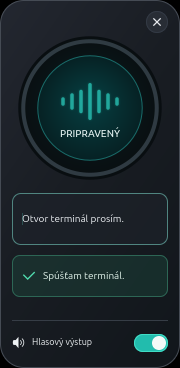

# Yoda – Voice Control

A compact GTK 4 voice-control panel for Ubuntu/GNOME. Hold Right Ctrl, speak a command, and release. Speech recognition runs locally through Voxtype; optional spoken confirmations use Piper and the Lili voice. No cloud API is needed for recognition or command execution.

**Yoda is tailored to Slovak:** the application interface, recognized commands and Lili voice are Slovak. This repository's documentation and help are in English. English command translations in the help explain their meaning; they are not additional recognized phrases.



## Usage

1. Open Yoda manually from the application menu or desktop shortcut.
2. Hold **Right Ctrl**, say one Slovak command, then release the key.
3. Yoda transcribes the recording, displays the text and executes only an exact allow-listed command.
4. To correct a transcription, edit the text field and press Enter.

Voxtype runs as Yoda's child process only while the window is open. Starting a recording interrupts Lili. Unknown text is not executed, and compound commands are not guessed into separate actions.

Examples: `otvor terminál` (open Terminal), `otvor súbory` (open Files), `hlasnejšie` (volume up), `tichšie` (volume down), `vypni zvuk` (mute), `zamkni počítač` (lock the session). You can append `prosím` (please).

**See [HELP.txt](HELP.txt) for the full English help and Slovak command list.**

## Requirements

Tested on Ubuntu 26.04.1, GNOME 50.1/Wayland, GTK 4.22 and Voxtype 1.1.1. Other distributions and versions have not been verified.

- System Python 3, PyGObject, Cairo and GTK 4. On Ubuntu, the relevant packages are `python3-gi`, `python3-cairo`, `python3-gi-cairo` and `gir1.2-gtk-4.0`.
- [Voxtype](https://voxtype.io), the locally installed multilingual Whisper `small` model and a working microphone.
- Voxtype access to keyboards through evdev. The tested setup uses membership in the `input` group, which grants broad access to input devices. Configure this deliberately for your distribution, then log out and back in if group membership changes.
- Optional spoken output: local Piper, `sk_SK-lili-medium.onnx` with its companion JSON configuration, and `mpv`.
- Individual actions require the corresponding applications: GNOME Terminal, Nautilus, `wpctl` and `loginctl`. Codex/OpenCode are needed only for their respective commands.

Recognition models, voice models and third-party binaries are not bundled. Obtain them from their maintainers with their applicable license terms.

## Complete Ubuntu installer

For a new Ubuntu GNOME PC, download **[Yoda-Ubuntu-Setup.run](https://raw.githubusercontent.com/Beso333/yoda-voice-manager/main/dist/Yoda-Ubuntu-Setup.run)** and run it as your regular desktop user:

```bash
bash Yoda-Ubuntu-Setup.run
```

This single file contains Yoda and its setup program. After confirmation, it installs Ubuntu dependencies, Voxtype, the Slovak Whisper model and optional Piper/Lili, creates the launchers and configures keyboard access. Internet and sudo privileges are required. Supports Ubuntu 24.04+ on 64-bit Intel/AMD; native testing has been on Ubuntu 26.04 only. You may need to log out and back in afterward.

The installer uses its own Voxtype configuration and preserves your global configuration. It does not start Yoda automatically or enable login autostart. **[Full setup instructions and options](docs/INSTALL-UBUNTU.md).**

## File-only installation

Install and verify the dependencies above first. The project installer downloads nothing, uses no sudo, changes no groups and enables no services.

```bash
git clone https://github.com/Beso333/yoda-voice-manager.git
cd yoda-voice-manager
python3 install.py
```

This installs `~/.local/bin/yoda-voice-manager`, an application-menu entry and the English help. Existing files with different contents are backed up before replacement. The example Voxtype configuration is copied only if no configuration exists.

For an optional desktop shortcut, pass your actual desktop directory:

```bash
python3 install.py --desktop-dir "$HOME/Desktop"
# A localized desktop directory may have another name, such as "$HOME/Plocha".
```

GNOME may require you to choose **Allow Launching** before opening the shortcut for the first time.

Check `~/.config/voxtype/config.toml` against [voxtype.example.toml](voxtype.example.toml). The `small` model must already be downloaded. If you have a separate `voxtype.service`, stop and disable it before opening Yoda to avoid two processes competing for the microphone and keyboard.

Yoda generates a temporary configuration at `$XDG_RUNTIME_DIR/voxtype/yoda-config.toml`, selecting file output, local Whisper, four inference threads and short-audio context optimization. It does not modify the persistent configuration. Use a clean local configuration without custom external hooks or post-processing; inherited Voxtype hooks can run other programs.

## Optional Lili voice

Default locations:

- Piper: `piper` on PATH, or `~/.local/bin/piper`.
- Model: `~/.local/share/yoda/voices/sk_SK-lili-medium.onnx`, with its JSON beside it.
- Saved voice-output setting: `~/.config/yoda/output-state`, respecting `XDG_CONFIG_HOME`.

Override paths when launching if necessary:

```bash
YODA_PIPER=/path/to/piper \
YODA_LILI_MODEL=/path/to/sk_SK-lili-medium.onnx \
~/.local/bin/yoda-voice-manager
```

`YODA_VOXTYPE` overrides the default `/usr/bin/voxtype` path. `YODA_VOXTYPE_CONFIG` selects a separate Voxtype configuration file; the complete installer sets this to `~/.config/yoda/voxtype.toml`. For application-menu launches, set these variables in your desktop session or customize the local desktop entry. Voice output is off by default on a fresh installation.

## Tests and diagnostics

```bash
/usr/bin/python3 yoda-voice-manager --self-test
/usr/bin/python3 test_yoda.py
```

The 17 regression tests need no microphone and trigger no real desktop actions; they use harmless test processes. PyGObject/GTK must be available to the system Python.

Native GNOME checks covered the 180 × 368 panel, a single application instance, local transcript routing, rejection of unknown phrases, opening Terminal, actual Piper/mpv playback and error reporting after Voxtype stops. See [docs/TESTING.md](docs/TESTING.md) for details and limitations.

- Log: `$XDG_RUNTIME_DIR/yoda-voxtype.log`.
- State: `$XDG_RUNTIME_DIR/voxtype/state`.
- After an unexpected Voxtype exit, close and reopen Yoda.
- Recognition accuracy and speed depend on the microphone, recording and hardware. Unknown transcriptions are not executed.
- The compact panel intentionally uses small text.

## Scope

Yoda provides a fixed set of Slovak desktop commands. It is not a general-purpose assistant. Codex/OpenCode desktop-entry names may need adjustment in `COMMANDS` for other installation methods. A successful result means the command or launcher returned zero; it does not verify another application's internal state.
